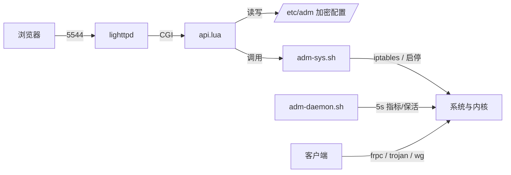

# RG-EG105G-P-L 路由器增强

> 给一台只有 **121 MB 内存、3.8 MB overlay** 的锐捷 RG-EG105G-P-L，加一套真正能用的独立管理台。
>
> 不刷机、不替换固件：原厂 80/443 保留，额外在 **5544** 启动 lighttpd + Lua CGI；
> FRP、Trojan、WireGuard、DDNS、防火墙、状态趋势、企业微信/钉钉通知都在一个页面里管理。

## 这是什么

- 一个**旁路管理台**，不是 OpenWrt 固件、不是刷机包；
- 管理 FRPC/FRPS、Trojan 服务端、WireGuard、DDNS、防火墙和通知；
- 闪存只放几十 KB 的压缩包，网页/脚本/二进制运行时释放到 `/tmp`；
- 内置一键还原：删除所有后期改动，保留原厂 80/443 与 SSH。

## 一张图



## 功能

| 模块 | 能力 |
|---|---|
| 状态 | 真实服务状态、监听端口、设备表、CPU/内存 3/6/12/24h 趋势 |
| FRP | xfrpc 内置，支持 tcp/udp/http/https/tcpmux/stcp/xtcp/sudp 与 P2P 回退 |
| Trojan | 自研最小服务端，TLS + SHA224 摘要，Clash 订阅 |
| WireGuard | 主动/被动端、`.conf` 导入、出口节点健康、紧急恢复 |
| 网络 | DDNS、防火墙表格/脚本双模式、命令行 |
| 运维 | 通知、配置加密、导入导出、一键还原 |

## 仓库说明

- **本仓**：二进制发布仓，只放 mipsle 可执行包和校验文件；
- **源码 / 教程 / 部署包**：私有仓 [`RG-EG105G-P-L-src`](https://github.com/air5210/RG-EG105G-P-L-src)
  （如需访问请联系作者）。其中的 `deploy/` 是自包含目录，含 Windows `deploy.bat`/`deploy.ps1`、
  Linux/macOS `deploy.sh` 和预构建 bundle，只下载该目录即可部署。

> 仅用于自己拥有设备的软件改造学习研究，请遵守当地法律法规，禁止用于未授权访问或违规用途。

---

## 二进制清单

| 文件 | 用途 | 大小 | SHA-256 |
|---|---|---|---|
| `bin/trojan-bundle.tar.gz` | Trojan 代理服务端 trojand（Go 自研，TLS+SOCKS5，UPX 压缩，mipsle softfloat） | 1.05 MB | `c9fc3c1ac0940f444998dd76efc9e61a1670371a426f1e5b8d9f6bdb5c648119` |
| `bin/wg-bundle.tar.gz` | WireGuard 用户态单二进制 `wg`（wireguard-go v0.0.20230223 + wgctrl 配置工具合并，UPX） | 853 KB | `fb912067544b4a4ba25580b367c69a35b3c443b339f9dafbf728b3595d9355ba` |
| `bin/xfrpc-bundle-509982.tar.gz` | xfrpc 5.09.982（OpenWrt 官方编译版 + OpenSSL3/libevent2/json-c 依赖，支持 frps≥0.69 wireProtocol v2） | 2.03 MB | `a2338007cb974bfa7e0bca8718f23d1215a7a139624aae0024c327c7105050bd` |

> 说明：项目早期使用过官方 frpc 0.58.1 / 0.71.0（约 15~17 MB），后因内存（121 MB）与
> frps 0.71 的 wireProtocol v2 兼容要求改用 xfrpc 5.09.982，官方 frpc 不再内置，
> 需要时请自行从 [fatedier/frp releases](https://github.com/fatedier/frp/releases) 下载
> `linux_mipsle` 版本。

## 下载方式（必须走 API，raw 直连不通）

国内网络对 `raw.githubusercontent.com` / `objects.githubusercontent.com` 基本不可达，
但 `api.github.com` 通常**直连可用**。本仓库统一使用 **Contents API** 取文件：

```sh
# 示例：下载 trojan-bundle.tar.gz
curl -H "Accept: application/vnd.github.raw" -o trojan-bundle.tar.gz \
  "https://api.github.com/repos/air5210/RG-EG105G-P-L/contents/bin/trojan-bundle.tar.gz"

# 校验
sha256sum -c checksums.txt
```

要点：

- **必须带** `-H "Accept: application/vnd.github.raw"`，否则 Contents API 默认返回
  JSON 包装（含 base64 的 JSON 文本），而不是文件本体；
- 该方式对 >1 MB 文件同样有效（raw 媒体类型上限 100 MB）；
- 匿名访问限速 60 次/小时/IP，自动化下载请低频使用（本管理台仅在二进制缺失时下载一次）。

## 配套管理台

所有二进制由路由器上的独立管理台（lighttpd + Lua CGI，端口 5544）统一管理：
trojan / wg / xfrpc 均支持「上传 / URL 下载 / 开机自动拉取」，下载地址填本仓库的
Contents API 链接即可（管理台已适配 `Accept: application/vnd.github.raw` 头）。
